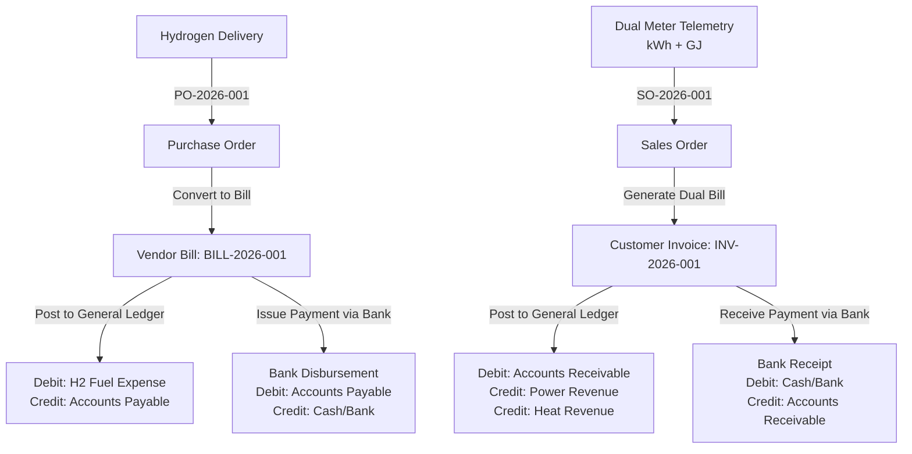

# Community Hydrogen Fuel Cell Micro-CHP & Building Heat Cogeneration Network

An enterprise-grade, full-stack distributed energy, utility billing, and financial accounting platform built with **Java 17, Spring Boot 3.2.4, Thymeleaf, Spring Data JPA, Spring Security, MySQL, and Chart.js**.

This platform combines real-time physical telemetry monitoring for combined heat and power (micro-CHP) fuel cells with a full ERP double-entry general ledger, dual energy utility billing (electricity kWh and space heat GJ), procurement workflows, and cogeneration unit budgeting.

---

## 1. Overview & Architecture

A distributed energy platform controlling combined heat and power (micro-CHP) fuel cells, delivering electricity and space heating to residential blocks, billing occupants, and managing cogeneration budgets.

### Primary Actors
1. **Admin (Cogeneration Operations Director)**: Sets heat-to-power output ratios, configures fuel tariffs, manages assets, and reviews system financial accounts.
2. **Invoicing User (Utility Accountant)**: Issues dual energy bills (kWh and thermal GJ) to housing co-ops, processes bulk pipeline hydrogen gas purchase orders (POs), and handles bank payment receipts and disbursements.
3. **Field Operator**: Dispatches fuel cell units, triages alarms, and manages stack overhaul work orders.
4. **System**: Ingests electrical and thermal meter telemetry, calculates combined utility bills, and automatically generates double-entry general ledger journal entries.

---

## 2. Master Data Modules

1. **Contact Master**:
   - **Residential Housing Co-op** (`CUSTOMER`): Greenfields Residential Housing Co-op, Riverside Eco-Housing Co-operative, Maplewood Senior Housing Association.
   - **Bulk Hydrogen Provider** (`VENDOR`): H2Pure Bulk Hydrogen Pipeline Ltd, Apex Fuel Cell Servicing & Overhaul Corp.
2. **Product Master**:
   - **Cogeneration Electricity kWh** (`GOODS`): Clean micro-CHP electrical power ($0.18 / kWh).
   - **Cogeneration Thermal Energy GJ** (`GOODS`): High-grade recovered space heat and hot water ($14.50 / GJ).
   - **Fuel Cell Stack Servicing** (`SERVICE`): Catalyst MEA reconditioning and preventative maintenance ($120.00 / Hour).
   - **Bulk Pipeline Hydrogen Gas** (`GOODS`): Green hydrogen fuel gas delivery ($5.50 / kg).
3. **Chart of Accounts (CoA) Master**:
   - **Assets**: `1010` Cash / Bank Account, `1200` Accounts Receivable (Housing Co-ops), `1510` Micro-CHP Fuel Cell Assets, `1520` Thermal Piping & District Loop.
   - **Liabilities**: `2010` Hydrogen Gas Provider Payables, `2020` Maintenance Creditors.
   - **Equity**: `3010` Co-op Retained Earnings & Capital.
   - **Income**: `4010` Micro-CHP Power Revenues, `4020` Micro-CHP Heat Revenues.
   - **Expenses**: `5010` Bulk Hydrogen Purchase Expenses, `5020` Fuel Cell Stack Servicing Costs.
4. **Journals**:
   - `SALES` (Sales Journal), `PURCH` (Purchase Journal), `BANK` (Bank Operating Journal), `CASH` (Cash Journal).
5. **Double-Entry Journal Entries**:
   - System-generated entries balancing energy sales against hydrogen gas purchases and stack maintenance costs:
     $$\sum \text{Debits} = \sum \text{Credits}$$

---

## 3. Transaction Flow



1. **Purchase Order (PO)**: Create PO for bulk pipeline hydrogen gas delivery.
2. **Vendor Bill**: Convert PO into Vendor Bill and issue payment via Bank.
3. **Sales Order (SO)**: Generate combined heat and power service order for housing co-op.
4. **Customer Invoice**: Convert consumption meter readings into Customer Invoice (dual energy: kWh electricity and GJ thermal space heat).
5. **Payment**: Receive payment from housing co-op via Bank.

---

## 4. Budget Flow & Cogeneration Units

1. **Analytic Account (Cogeneration Unit)**:
   - Tracks financial costs and revenues per unit: `Housing Sector CHP 1`, `Housing Sector CHP 2`, `District Center CHP 3`, `Civic Park CHP 4`.
2. **Budgeting Engine**:
   - Compares planned unit operating budgets against actual hydrogen gas purchases and combined energy revenues.
   - Computes planned vs. actual revenues, fuel expenses, net operating margin, and variance percentages.

---

## 5. Financial Reporting Statements

1. **Balance Sheet (`/accounting/balance-sheet` and `GET /api/reports/balance-sheet`)**:
   - Fuel cell machinery assets ($320,000), thermal piping ($140,000), cash balances ($245,000), accounts receivable ($18,400) vs. hydrogen supplier payables ($12,500) and maintenance creditors ($4,200).
2. **Profit & Loss Account (`/accounting/profit-loss` and `GET /api/reports/pl`)**:
   - Power and heat revenues minus bulk hydrogen purchases and stack maintenance expenses.
3. **Cogeneration Budget Report (`/budgets` and `GET /api/reports/budget`)**:
   - Micro-CHP unit budget performance report comparing planned vs. actual performance by analytic unit.

---

## 6. Key Use-Case Steps & REST API Reference

| Use-Case Step | HTTP Method | Endpoint | Description |
| :--- | :---: | :--- | :--- |
| **1. Create Master Data** | `POST` | `/api/chp/units` | Add micro-CHP unit and register Cogeneration Analytic Account |
| | `GET` | `/api/chp/units` | Get summary of all micro-CHP units |
| **2. Dual Meter Telemetry** | `POST` | `/api/chp/telemetry` | Ingest electricity & thermal telemetry; calculate net kWh and GJ |
| | `GET` | `/api/chp/telemetry` | Retrieve recent dual meter telemetry readings |
| **3. Execute Invoicing** | `POST` | `/api/invoicing/customer-invoice` | Issue dual energy Customer Invoice to housing co-op |
| | `GET` | `/api/invoicing/customer-invoices` | List all customer invoices |
| | `POST` | `/api/invoicing/vendor-bill` | Process Vendor Bill for bulk hydrogen delivery |
| | `GET` | `/api/invoicing/vendor-bills` | List all vendor bills |
| | `POST` | `/api/invoicing/payments` | Record bank receipt or vendor disbursement |
| | `GET` | `/api/invoicing/payments` | List all bank transactions |
| **4. Generate Reports** | `GET` | `/api/reports/pl` | Run Micro-CHP Profit & Loss report |
| | `GET` | `/api/reports/balance-sheet` | Run Balance Sheet statement |
| | `GET` | `/api/reports/budget` | Run Cogeneration Unit budget performance report |
| | `GET` | `/api/reports/journal-entries` | Retrieve all double-entry general ledger entries |

---

## 7. Operational Telemetry & Thermodynamic Formulas

- **Hydrogen Lower Heating Value (LHV):** $33.33\text{ kWh/kg}$
- **Electrical Efficiency:** $\eta_e = \frac{P_{elec}}{\dot{m}_{H2} \times 33.33} \times 100\%$
- **Thermal Efficiency:** $\eta_{th} = \frac{Q_{th}}{\dot{m}_{H2} \times 33.33} \times 100\%$
- **Combined CHP Efficiency:** $\eta_{CHP} = \eta_e + \eta_{th}$
- **Heat-to-Power Ratio:** $R_{H/P} = \frac{Q_{th} (\text{kW})}{P_{elec} (\text{kW})}$
- **Gigajoule Conversion:** $1\text{ kWh}_{th} = 0.0036\text{ GJ}$
- **Avoided Carbon Emissions:** $\Delta CO_2 = \text{kWh} \times 0.42\text{ kg CO}_2/\text{kWh}$

---

## 8. User Accounts & Default Credentials

| Role | Name | Username | Password | Privileges |
| :--- | :--- | :--- | :--- | :--- |
| **ADMIN** | Cogeneration Operations Director | `jaiagash.r2025ece@sece.ac.in` | `admin123` | Full access: tariffs, CoA, machinery, alerts, dispatch |
| **ACCOUNTANT** | Utility Accountant (Invoicing User) | `accountant@h2energy.net` | `account123` | Dual energy billing, POs, vendor bills, bank receipts, budgets |
| **OPERATOR** | Field Operator | `operator@h2energy.net` | `op123` | Fuel cell control, telemetry monitoring, maintenance orders |
| **VIEWER** | Community Viewer | `viewer@h2energy.net` | `view123` | Read-only access to dashboard, community grid, reports |

---

## 9. How to Run Locally

### Requirements
- **Java 17** or higher
- **MySQL 8.0+**
- Maven (or use included `./mvnw`)

### Quick Start
1. Ensure MySQL is running with database `hydrogen_chp_network` (or allow Spring Boot auto-creation via `application.properties`).
2. Run the application:
   - **One-Click Run (Windows)**:
     ```powershell
     # In jp1 directory or ecea directory:
     .\run.bat
     # OR in PowerShell:
     .\run.ps1
     ```
   - **Manual Terminal Command**:
     ```powershell
     # Navigate to project folder:
     cd ecea

     # Run with Maven Wrapper:
     $env:JAVA_HOME = "C:\Users\agash\.jdks\ms-17.0.20.1"; .\mvnw.cmd spring-boot:run
     ```
   - **Linux / macOS**:
     ```bash
     ./mvnw spring-boot:run
     ```
3. Open browser at **`http://localhost:8080`**.
4. Log in using `jaiagash.r2025ece@sece.ac.in` / `admin123` or `accountant@h2energy.net` / `account123`.

